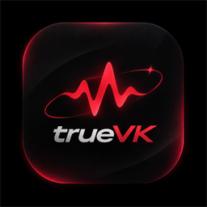

# trueVK



**trueVK** — небольшой нативный плеер музыки ВКонтакте для Windows 11 (x64), написанный на Rust. Сделан как лёгкая замена браузеру в играх, например в CS2: почти не нагружает процессор и память. Без Electron, Tauri и webview.

Работает с вашим собственным аккаунтом VK, только с аудио.

## Что умеет

- Вкладки: «Моя музыка», плейлисты, поиск и рекомендации.
- Добавление и удаление треков из своей музыки (кнопки «+» и «×», удаление с подтверждением).
- Очередь привязана к треку, а не к номеру строки: переключение вкладок и новый поиск её не сбивают.
- Prev/Next, автопродолжение, громкость и перемотка.
- Медиаклавиши, горячие клавиши `Space` и `Ctrl+←/→` (не срабатывают, когда поле ввода в фокусе).
- Закрытие окна сворачивает программу в трей; выход из трея завершает её полностью.
- Запоминаются громкость и последний воспроизведённый трек.
- Аудио потоково воспроизводится из оперативной памяти: треки не скачиваются на диск, кэш музыки не создаётся.
- Токен VK и User-Agent хранятся в Windows Credential Manager; в `%APPDATA%\vkmusic\settings.json` пишутся только настройки, без секретов.

## Скриншоты


## Установка

1. Скачайте `trueVK-Setup-0.1.0.exe` из раздела [Releases](https://github.com/bledniyxvi/trueVK/releases).
2. Запустите установщик. Права администратора не требуются.
3. По умолчанию программа ставится в `%LOCALAPPDATA%\Programs\trueVK`. Ярлык в меню «Пуск» создаётся всегда, ярлык на рабочем столе — по желанию.

## Первый запуск

При первом запуске введите токен доступа VK и User-Agent в окне программы. Они сохранятся в Windows Credential Manager и больше не будут запрашиваться. Для командной строки предусмотрены переменные окружения `VK_TOKEN` и `VK_UA`.

Токен не записывается в файлы настроек и не попадает в лог.

## Сборка из исходников

Нужны Rust с поддержкой edition 2024 и установленный Microsoft C++ Build Tools.

```powershell
git clone https://github.com/bledniyxvi/trueVK.git
cd trueVK
cargo build --release
```

Готовый исполняемый файл: `target\release\truevk.exe`.

Чтобы собрать установщик, нужен Inno Setup 7:

```powershell
powershell -ExecutionPolicy Bypass -File installer\build.ps1
```

Скрипт сам соберёт Release, создаст `installer\Output\trueVK-Setup-0.1.0.exe` и выведет его размер и SHA256.

## Структура

- `src/main.rs` — точка входа и служебные режимы.
- `src/api.rs` — клиент VK API.
- `src/player.rs` — загрузка и воспроизведение из памяти.
- `src/gui.rs` — интерфейс, очередь, горячие клавиши и трей.
- `src/storage.rs` — токен в Credential Manager и локальные настройки.
- `src/theme.rs` — цвета и оформление.
- `assets/` — иконки и шрифты.
- `installer/` — скрипт сборки установщика и файл проекта Inno Setup.

## Лицензия

Лицензия на код не указана. Шрифты в `assets/fonts` распространяются по SIL Open Font License; тексты лицензий лежат рядом с файлами шрифтов.
