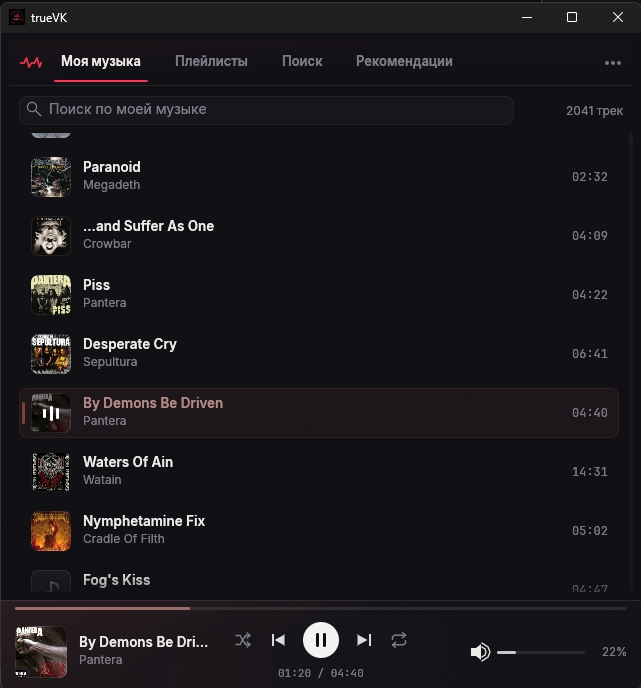

<div align="center">


<h1>trueVK</h1>

<p><strong>Музыка ВКонтакте без браузера.<br />Без Electron, Tauri и webview. Просто Rust и окно.</strong></p>

<p>
  <a href="https://github.com/bledniyxvi/trueVK/releases"></a>
  <a href="https://github.com/bledniyxvi/trueVK/releases"></a>
  
  
  
</p>

<p>
  <a href="https://github.com/bledniyxvi/trueVK/releases/latest/download/trueVK-Setup-0.2.0.exe"></a>
</p>

</div>

## Зачем это не браузер

| | trueVK | Вкладка браузера |
|---|---|---|
| Запуск | сразу, одно окно | браузер + вкладка + расширения |
| Память | аудио живёт в RAM | целый webview и процесс вкладки |
| Файлы на диске | кэша музыки нет | кэш, куки, профиль |
| Управление | медиаклавиши, трей, горячие клавиши | только вкладка |
| Установщик | 6,5 МБ, без прав администратора | — |

## Что умеет

<table>
<tr>
<td width="50%" valign="top">

**Музыка**

- Вкладки: «Моя музыка», плейлисты, поиск и рекомендации.
- Добавление и удаление треков: кнопки `+` и `×`, удаление с подтверждением.
- Очередь привязана к треку, а не к номеру строки: переключение вкладок и новый поиск её не сбивают.
- Prev/Next, автопродолжение, громкость и перемотка.
- Контекстное меню трека: «Похожие треки» (радио по выбранному треку) и «Сохранить MP3» для играющего трека.

</td>
<td width="50%" valign="top">

**Опыт**

- Медиаклавиши и горячие клавиши `Space`, `Enter`, `←/→`; в поле ввода они не мешают.
- Закрытие окна сворачивает программу в трей, выход из трея завершает её полностью.
- Запоминаются громкость, последний трек и размер окна.
- Аудио играет из оперативной памяти: треки не скачиваются на диск без вашей команды.
- Громкость регулируется по плавной кривой, звук появляется и исчезает без щелчков.
- При смене или ошибке аудиоустройства плеер сам пересоздаёт поток и продолжает с той же позиции.
- Токен VK и User-Agent лежат в Windows Credential Manager, а не в файлах настроек.

</td>
</tr>
</table>

### Горячие клавиши

| Клавиша | Действие |
|---|---|
| <kbd>Space</kbd> | пауза / продолжить |
| <kbd>Enter</kbd> | играть выбранный трек |
| <kbd>←</kbd> / <kbd>→</kbd> | перемотка на 5 секунд назад / вперёд |
| Медиаклавиши | play/pause, stop, следующий, предыдущий |

## Что нового в 0.2.0

- **Мгновенный запуск.** Метаданные треков и плейлистов кэшируются локально (`cache.json`, без ссылок и токенов) — музыка видна сразу и тихо обновляется с сети.
- **Быстрое переключение.** Следующий трек заранее загружается в RAM, пока играет текущий.
- **Без щелчков.** Плавное затухание звука (~40 мс) при паузе, возобновлении и смене трека.
- **Похожие треки.** Радио по выбранному треку через рекомендации VK, без ручного поиска.
- **Сохранение MP3.** Играющий трек можно сохранить в «Музыку» или «Загрузки» с именем «Исполнитель - Название».
- **Устойчивый звук.** При смене аудиоустройства поток пересоздаётся, трек продолжается с текущей позиции.
- **Окно запоминается.** Позиция и размер восстанавливаются при следующем запуске.
- **Умные повторы.** При таймауте и обрыве связи запросы повторяются автоматически; обрезанный поток не воспроизводится.
- **Производительность.** Кэш отфильтрованного списка, скрытое окно не просыпается зря, аудиобуфер не копируется лишний раз.
- Понятное сообщение, если VK просит капчу.

## Как выглядит

<table>
<tr>
<td width="50%" valign="top"></td>
<td width="50%" valign="top"></td>
</tr>
</table>

<p align="center">Скриншот 1 · Скриншот 2</p>

## Установка

1. [Скачать `trueVK-Setup-0.2.0.exe`](https://github.com/bledniyxvi/trueVK/releases/latest/download/trueVK-Setup-0.2.0.exe) или зайти в [Releases](https://github.com/bledniyxvi/trueVK/releases).
2. Запустить установщик — права администратора не нужны.
3. По умолчанию программа ставится в `%LOCALAPPDATA%\Programs\trueVK`. Ярлык в меню «Пуск» создаётся всегда, ярлык на рабочем столе — по желанию.

<details>
<summary>SHA256 установщика</summary>

`9F4E8F916333C6A402F1077603311AE19DD8C6CB0DB54136C88264A44568F8AD`

</details>

## Первый запуск

При первом запуске вставьте ссылку на любой трек VK или токен доступа в окне программы. Токен извлекается из ссылки автоматически, User-Agent подставляется сам. Они сохранятся в Windows Credential Manager и больше не будут запрашиваться. Для разработки можно заранее задать переменные окружения `VK_TOKEN` и `VK_UA` — они имеют приоритет.

Токен не записывается в файлы настроек и не попадает в лог. В `%APPDATA%\vkmusic\settings.json` хранятся только настройки, а в `cache.json` — метаданные треков для мгновенного запуска (без ссылок и токенов).

## Сборка из исходников

Нужны Rust с поддержкой edition 2024 и установленный Microsoft C++ Build Tools.

```powershell
git clone https://github.com/bledniyxvi/trueVK.git
cd trueVK
cargo build --release
```

Готовый исполняемый файл: `target\release\truevk.exe`.

Чтобы собрать установщик, нужен Inno Setup 7:

```powershell
powershell -ExecutionPolicy Bypass -File installer\build.ps1
```

Скрипт сам соберёт Release, создаст `installer\Output\trueVK-Setup-0.2.0.exe` и выведет его размер и SHA256.

<details>
<summary>Структура проекта</summary>

- `src/main.rs` — точка входа, логи и защита от второго экземпляра.
- `src/api.rs` — клиент VK API.
- `src/player.rs` — загрузка и воспроизведение из памяти.
- `src/gui.rs` — интерфейс, очередь, горячие клавиши и трей.
- `src/storage.rs` — токен в Credential Manager и локальные настройки.
- `src/theme.rs` — цвета и оформление.
- `assets/` — иконки и шрифты.
- `installer/` — скрипт сборки установщика и файл проекта Inno Setup.

</details>

## Лицензия

Лицензия на код не указана. Шрифты в `assets/fonts` распространяются по SIL Open Font License; тексты лицензий лежат рядом с файлами шрифтов.
